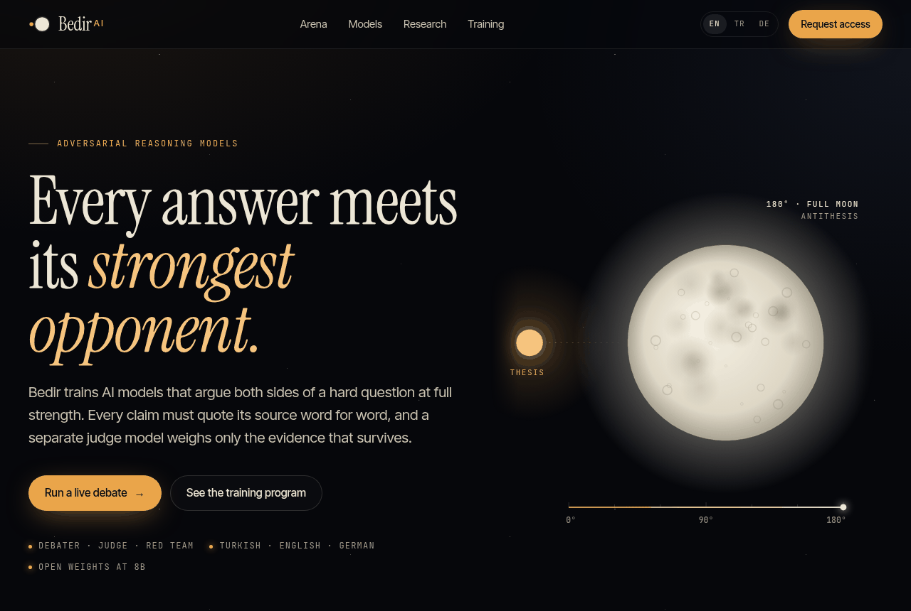
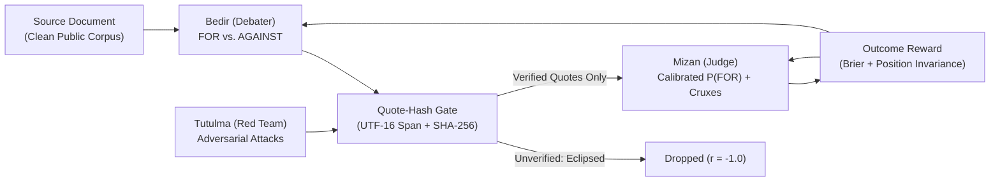
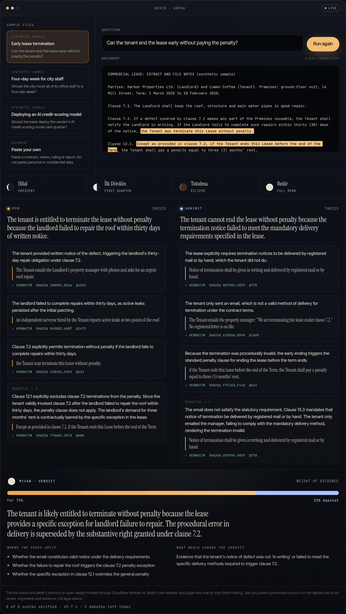

<p align="center">
  
</p>

<p align="center">
  <a href="https://github.com/bedirai/bedir-ai/actions/workflows/ci.yml"></a>
  <a href="LICENSE"></a>
  
  
  <a href="https://bedirsavasi.com/arena/"></a>
</p>

# BedirAI

**Adversarial reasoning models. Every answer meets its strongest opponent.**

Bedir makes two AI debaters argue opposite answers to a hard question about a document, at full strength. Every claim must quote the document word for word. Each quote is checked on the server and hashed with SHA-256, and any claim whose quote is not in the text is *eclipsed* before the judge sees it. A separate judge model, **Mizan**, weighs only the evidence that survives and returns a calibrated probability, the points where the sides split and the evidence that would change its verdict.

*Bedir* means full moon. The moon is full only in opposition, when it stands 180° from the sun. An argument is complete only when it faces the strongest case against it.

[**Try the live Arena →**](https://bedirsavasi.com/arena/) &nbsp;·&nbsp; [Protocol & API](docs/protocol.md) &nbsp;·&nbsp; [Training Program](docs/TRAINING.md) &nbsp;·&nbsp; [Evaluation & Metrics](docs/EVALUATION.md) &nbsp;·&nbsp; [Model Cards](docs/MODEL_CARDS.md) &nbsp;·&nbsp; [Data Governance](docs/DATA_GOVERNANCE.md) &nbsp;·&nbsp; [Roadmap](docs/ROADMAP.md)

---

## Architecture: four models, one adversarial loop



| Model | Role | Target scale | Reward | Release | Status |
|---|---|---|---|---|---|
| **Bedir** | Two-sided debater | 8B → ~32B → MoE | Zero-sum judge probability, quote-hash gated, 150-word cap | API & on-prem weights | Phase 1 |
| **Mizan** | Calibrated judge | 8B → 32B | Negative Brier score on real outcomes + position invariance | **8B open weights**; 32B API | Pilot |
| **Tutulma** | Red team | 8B → 32B | Probability shift toward wrong outcome (hardens Mizan) | **Private (safety policy)** | Phase 1 |
| **Hilal** | Compact single-server | 8B dense | Distilled from Bedir & Mizan on verified evidence | **Apache-2.0 open weights** | Pilot |

The live public [Arena](https://bedirsavasi.com/arena/) runs the four-phase protocol on open-weight models via Cloudflare Workers AI; BedirAI's trained debater and judge take over as each training phase completes.

## The Arena

<p align="center">
  
</p>

---

## Quickstart (zero dependencies, Python 3.9+)

```bash
git clone https://github.com/bedirai/bedir-ai.git
cd bedir-ai

# 1. Run a live debate and re-verify every SHA-256 quote hash locally
python3 -m bedir --sample en-commercial-lease

# 2. Replay a recorded debate completely offline
python3 -m bedir --replay examples/debates/tr-dort-gunluk-hafta.json

# 3. Audit all recorded debates and validate the Mizan-Bench schema
python3 -m bedir.eval --debates examples/debates
python3 -m bedir.eval --validate-bench benchmarks/mizan_bench_sample.jsonl

# 4. Inspect first-principles Phase 1 compute budgets (CUDA H100 / H200 & ROCm MI250X / MI300X / MI355X)
python3 -m training.compute_model --phase phase1 --hardware H100 --sensitivity
python3 -m training.compute_model --phase phase1 --hardware MI355X

# 5. Run the full test suite
python3 -m unittest discover -s tests -v
```

Use your own text (200 to 12,000 characters) and a yes-or-no question:

```bash
python3 -m bedir --document memo.txt --question "Should we approve the vendor?" --lang en
```

A Node.js 18+ client is in [`examples/javascript/debate.mjs`](examples/javascript/debate.mjs).

---

## What is in this repository

| Path | What it provides |
|---|---|
| [`bedir/verify.py`](bedir/verify.py) | Deterministic verbatim quote matcher with UTF-16 offsets and SHA-256 digests (paraphrases never pass) |
| [`bedir/rewards.py`](bedir/rewards.py) | RL reward functions for **Mizan** (Brier + position invariance), **Bedir** (zero-sum + quote-hash gate + 150-word cap + counterfactual necessity), **Tutulma**, and drop-in `verl` `custom_reward_function` hook (`verl_compute_score`) |
| [`bedir/metrics.py`](bedir/metrics.py) | Scalable-oversight diagnostics: `outcome_accuracy`, `brier_score`, `expected_calibration_error`, `truth_advantage` (TA), `persuasion_shift` (PS), `performance_gap_recovered` (PGR), `position_flip_rate`, `rhetoric_sensitivity`, `hack_rate`, `cross_lingual_consistency` and master-key judge probes |
| [`bedir/lineage.py`](bedir/lineage.py) | Programmatic data-governance gate: blocks closed frontier API outputs and eval-only corpora from training splits, redacts residual PII (TCKN checksum, IBAN, email, phone, IPv4) and audits temporal hold-outs |
| [`bedir/eval.py`](bedir/eval.py) | Reproducible CLI harness for transcript quote audits, Mizan-Bench validation and judge evaluation |
| [`bedir/client.py`](bedir/client.py), [`bedir/cli.py`](bedir/cli.py) | Streaming NDJSON client and terminal UI for the live Arena API |
| [`training/compute_model.py`](training/compute_model.py) | First-principles FLOP, memory and GPU-hour job-table planner across H100, H200, MI250X, MI300X and MI355X |
| [`training/configs/`](training/configs) | `verl` (FSDP + vLLM) RL configurations for Phase 0 (8B pilot) and Phase 1 (32B self-play + Tutulma hardening) |
| [`training/scaling/`](training/scaling) | 4→8→16→32-GPU strong/weak scaling benchmark analyser and schema |
| [`benchmarks/`](benchmarks) | Time-locked multilingual `Mizan-Bench` JSONL schema and 9-case synthetic preview |
| [`examples/`](examples) | Recorded live debates (EN / TR / DE), 9 synthetic case documents and Node.js client |
| [`docs/`](docs) | [`protocol.md`](docs/protocol.md), [`TRAINING.md`](docs/TRAINING.md), [`EVALUATION.md`](docs/EVALUATION.md), [`MODEL_CARDS.md`](docs/MODEL_CARDS.md), [`DATA_GOVERNANCE.md`](docs/DATA_GOVERNANCE.md), [`ROADMAP.md`](docs/ROADMAP.md) |

---

## Training program & compute summary

Our training program is gated by proof points: **Phase 1 (~32B) starts only after Phase 0 proves debate lifts Mizan-8B accuracy on real outcomes and produces measured 4→32-GPU scaling logs.**

| Phase | Scope | Compute | Status |
|---|---|---|---|
| **Phase 0 · Pilot** | Hilal-8B & Mizan-8B; 4→32-GPU scaling on AMD MI250X; Mizan-Bench v0 | 8B scale (~2,200 H100-h eq.) | Pilot |
| **Phase 1 · Core models** | Shared 32B CPT (~40B tokens); Mizan-32B RL & hardening; Bedir-32B self-play RL; Tutulma rounds | **≈ 110,000 H100-hours** (range 100k–130k) | 12 months |
| **Phase 2 · Scale** | Mixture-of-experts debater (~20B active, GSPO), more languages & domains | ≈ 500,000 H100-hours | From 2027 |

- **Hardware-agnostic stack:** AMD ROCm (`MI250X`, `MI300X`, `MI355X`) and NVIDIA CUDA (`H100`, `H200`), running `verl` (FSDP) + `vLLM` rollouts.
- **Clean data lineage (zero frontier distillation):** Frontier model APIs are used **only** for weak-to-strong oversight experiments (45%), public benchmark baselines (25%), red-team evaluation (20%) and engineering (10%). **0% of frontier API outputs enter training data.** Enforced in code by [`bedir/lineage.py`](bedir/lineage.py).
- **Open-by-default outputs:** `Hilal-8B` (Apache-2.0), `Mizan-8B` open weights, time-locked `Mizan-Bench` (TR / EN / DE), verifier & evaluation harness, scaling tables, hack-rate curves and technical report.

See [`docs/TRAINING.md`](docs/TRAINING.md) and [`docs/DATA_GOVERNANCE.md`](docs/DATA_GOVERNANCE.md) for full details.

---

## Use the verifier and RL reward hooks in Python

```python
from bedir import check, debater_reward, mizan_reward, verl_compute_score
from bedir.lineage import check_source_policy

# 1. Mizan calibrated judge reward (Brier + position-swap invariance)
r_judge = mizan_reward(p_for=0.80, outcome=1, p_swapped=0.22)

# 2. Bedir debater reward: hard-gated on verbatim quote matching + 150-word cap
doc = open("examples/documents/en-commercial-lease.txt").read()
claims = [{
    "text": "Clause 7.2 permits termination without penalty after thirty days.",
    "quote": "If the Landlord fails to complete such repairs within thirty (30) days of the notice, the Tenant may terminate this Lease without penalty.",
}]
r_debater = debater_reward("for", p_for=0.75, claims=claims, document=doc)
assert r_debater.quote_gate_passed and r_debater.total > 0

# 3. Programmatic data-lineage gate: blocks frontier APIs from training splits
assert not check_source_policy(
    {"id": "eval-baseline", "license": "Frontier-API-Output", "provider": "anthropic-api", "pii_redacted": True},
    split="train",
).allowed
```

---

## Recorded live debates

Real runs against the live API on 20 November 2026 in [`examples/debates/`](examples/debates), verified locally in CI on every push:

| File | Language | Question | Quotes verified | Mizan |
|---|---|---|---|---|
| [`en-commercial-lease.json`](examples/debates/en-commercial-lease.json) | English | Can the tenant end the lease early without paying the penalty? | 8 of 8 | 75% for |
| [`tr-dort-gunluk-hafta.json`](examples/debates/tr-dort-gunluk-hafta.json) | Turkish | Should the city move all office staff to a four-day week? | 8 of 8 | 35% for |
| [`de-ki-kreditmodell.json`](examples/debates/de-ki-kreditmodell.json) | German | Should the bank deploy the vendor's AI credit-scoring model? | 8 of 8 | 35% for |

---

## Key references

- Irving, Christiano, Amodei (2018). *AI safety via debate.* [arXiv:1805.00899](https://arxiv.org/abs/1805.00899)
- Khan et al. (ICML 2024). *Debating with more persuasive LLMs leads to more truthful answers.* [PMLR v235](https://proceedings.mlr.press/v235/khan24a.html)
- Kenton et al. (NeurIPS 2024). *On scalable oversight with weak LLMs judging strong LLMs.* [arXiv:2407.04622](https://arxiv.org/abs/2407.04622)
- Kenton et al. (2026). *Debate training reduces reward hacking in RLAIF.* [arXiv:2608.17776](https://arxiv.org/abs/2608.17776)
- Damani et al. (ICLR 2026). *RLCR: Training language models to reason about their uncertainty.* [arXiv:2507.16806](https://arxiv.org/abs/2507.16806)
- *Post-rationalization in RLVR-trained search agents.* (2026). [arXiv:2609.23053](https://arxiv.org/abs/2609.23053)
- *One token to fool LLM-as-a-judge.* (2025). [arXiv:2507.08794](https://arxiv.org/abs/2507.08794)

Full bibliography in [`docs/EVALUATION.md`](docs/EVALUATION.md).

## Use, limits & licence

- The public Arena API has a daily limit per network. Do not send personal or confidential data; submitted text is processed once and not stored.
- A verified quote proves that the words appear in the document; it does not prove that a claim is true.
- Bedir surfaces arguments and evidence; it is not legal, financial or professional advice and does not predict live case outcomes.
- **Licence:** Apache License 2.0 ([LICENSE](LICENSE)). Cite via [`CITATION.cff`](CITATION.cff).

**Contact:** merhaba@bedirsavasi.com · [bedirsavasi.com](https://bedirsavasi.com)
